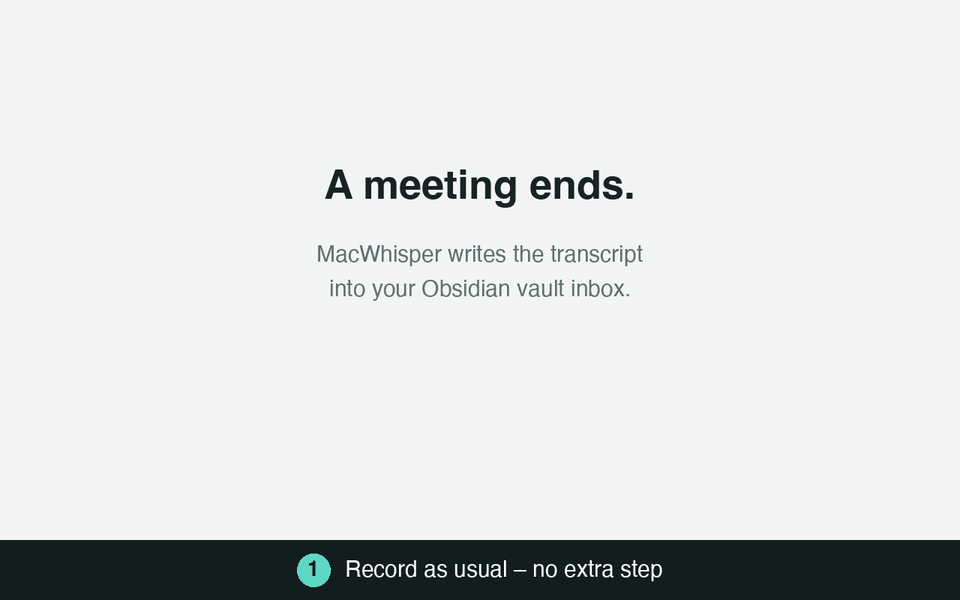

# Debrief

[English](README.md) · **Deutsch**

**Jede Besprechungsaufnahme landet nach einem kurzen Review am richtigen Ort in deinem Obsidian-Vault – mit Zusammenfassung, Entscheidungen und Todos.**



*Demo mit erfundenen Daten: Aus einer Aufnahme wird eine Notiz in `Clients/Acme/platform-migration/Erika Mustermann/`.*

## Wozu Debrief

Besprechungen aufzunehmen ist einfach. Sie nutzbar zu machen ist die Arbeit: Transkripte stapeln sich im
Eingang, niemand liest sie noch einmal, Todos stecken im Fließtext, und das manuelle Ablegen fällt als Erstes weg.

Debrief macht aus dem Stapel eine Wissensbasis, die du wirklich nutzt:

| Ohne Debrief | Mit Debrief |
|---|---|
| Transkripte liegen ungelesen in einem Ordner | Jedes ist nach Kunde, Projekt und Person dort abgelegt, wo du es suchen würdest |
| Todos stecken irgendwo in 40 Minuten Text | Deine Todos sind `- [ ]`-Kästchen für das Obsidian-Plugin *Tasks*, die der anderen nennen Zuständige und Termin |
| „Was haben wir entschieden?“ heißt im Transkript suchen | Zusammenfassung und Entscheidungen stehen oben in jeder Notiz |
| Sprecher heißen „Speaker 1“ und „Speaker 2“ | Das Modell schlägt vor, wer wer ist (nach Anrede und Kalendereinladung) |
| Die Folge-Mail schreibst du aus dem Gedächtnis | Ein Entwurf entsteht aus Zusammenfassung, Entscheidungen und Todos |
| Alles einer KI zu überlassen heißt blind vertrauen | Nichts wird abgelegt, bevor du es auf einer lokalen Review-Seite bestätigt hast; deine Korrekturen lehren das Modell |
| Vertrauliche Gespräche verlassen das Haus | Optional läuft alles über ein selbst betriebenes LiteLLM-kompatibles Gateway, die Transkripte bleiben im Haus |

Du prüfst einen Vorschlag, statt von Hand abzulegen, und das Ergebnis ist
schlichtes Markdown in deinem eigenen Vault: kein Lock-in, keine neue App, in der du leben musst.

## So funktioniert es

```
MacWhisper ──(Obsidian-Integration)──▶ Vault/transkripts/
                                              │  server.py (macOS-Dateisystem-Ereignisse)
                                              ▼
                                    LLM-Analyse (claude -p, optional über eigenes Gateway)
                                              │  Vorschlag in pending/
                                              ▼
                       Mitteilung ──Klick──▶ Review-Seite http://debrief.localhost:8765
                                              │  „In Obsidian ablegen“
                                              ▼
                       Vault/<Ordner der Kategorie>[/<Projekt>[/<Person>]]/<Datum> <Titel>.md
```

## Voraussetzungen

| Was | Wofür | Installation |
|---|---|---|
| [mise](https://mise.jdx.dev) (**Pflicht**) | installiert `uv`, `terminal-notifier`, `jq` und stellt die Tasks bereit (siehe `mise.toml`) | `brew install mise` oder `curl https://mise.run \| sh` |
| [Claude Code](https://docs.claude.com/en/docs/claude-code) (`claude`) | führt die Analyse aus | `curl -fsSL https://claude.ai/install.sh \| bash` |
| Obsidian + Plugin **Local REST API** | MacWhisper schreibt darüber in den Vault | Obsidian → Community-Plugins |
| Xcode Command Line Tools (`swiftc`, optional) | baut das Kalender-Hilfsprogramm | `xcode-select --install` |
| Obsidian-Plugin **Task Board** (optional) | Kanban-Board über alle Todos. Board-Vorlage `templates/task-board-todos.json`: bei ausgeschaltetem Plugin in `.obsidian/plugins/task-board/data.json` als `data.boardConfigs[0]` eintragen, dann Plugin einschalten und „Scan Vault“ | Obsidian → Community-Plugins |
| Obsidian **Bases** (eingebaut, ab 1.9) | Gesprächsübersicht – Vorlage `templates/Conversations.base` in den Vault kopieren | – |
| Obsidian-Plugin **Tasks** (optional) | Todo-Übersicht über alle Notizen – Vorlage `templates/Todos.md` in den Vault kopieren; `templates/debrief-tasks.css` nach `.obsidian/snippets/` (Datum vorne) und unter Einstellungen → Darstellung → CSS-Snippets einschalten | Obsidian → Community-Plugins |

**mise ist Pflicht:** Der Dienst startet über `mise exec`, und alle Werkzeuge außer
`claude` kommen aus `mise.toml`. Einen `terminal-notifier` aus dem Ruby-Gem ignoriert der
Server, weil das eine Intel-Binary ist (Rosetta-Warnung).

## Installation

```sh
git clone https://github.com/schowave/debrief.git && cd debrief
mise trust && mise run install   # Werkzeuge + launchd-Dienst einrichten und starten
```

Beim ersten Mal legt der Installer `config.yaml` und `categories.yaml` aus den `*.example.yaml` an und hält an:
Vault-Pfad, Name und Kategorien anpassen, dann `mise run install` erneut ausführen. Beide Dateien stehen in der
`.gitignore` – persönliche Daten landen so nicht im Repository.

### mise-Tasks

| Task | Zweck |
|---|---|
| `mise run install` | Werkzeuge installieren, Dienst einrichten bzw. neu laden |
| `mise run uninstall` | Dienst entfernen (Dateien und Vorschläge bleiben) |
| `mise run restart` | Dienst neu starten (nach Code- oder `config.yaml`-Änderungen) |
| `mise run status` | Läuft der Dienst? Welche Vorschläge sind offen? |
| `mise run open` | Review-Seite öffnen |
| `mise run logs` | Logs live verfolgen |
| `mise run dev` | Server im Terminal starten; der Dienst pausiert solange und startet danach wieder |
| `mise run calendar-access` | Kalenderzugriff des Hilfsprogramms anfragen bzw. prüfen |
| `mise run dry-run` | Inbox analysieren, nur anzeigen |
| `mise run sort` | Direktmodus: ohne Review einsortieren |

`mise run install` und `mise run uninstall` rufen `install.sh` auf.

`install.sh` erzeugt aus `launchd.plist.template` die Datei
`~/Library/LaunchAgents/de.<user>.debrief.plist` mit den Pfaden des
aktuellen Rechners. Der Dienst startet beim Login und wird bei Absturz neu gestartet.
Beim ersten Einrichten meldet macOS „Hintergrundobjekt hinzugefügt“; unter Systemeinstellungen →
Allgemein → Anmeldeobjekte → „Im Hintergrund erlauben“ erscheint er als `debrief`
und muss dort erlaubt bleiben.
Nach Änderungen an `config.yaml` oder am Code: `mise run restart`.
Entfernen: `mise run uninstall`.

### MacWhisper einrichten

Einstellungen → Integrationen → **Obsidian**:
- IP-Adresse/Port/API-Token aus dem Local-REST-API-Plugin
- Ordner: derselbe wie `inbox` in `config.yaml` (Standard `/transkripts`)

Sprecher in MacWhisper benennen lohnt sich: dann stimmen die Verantwortlichen bei den Todos.

## Konfiguration

**`config.yaml`**

| Schlüssel | Bedeutung |
|---|---|
| `vault` | Pfad zum Obsidian-Vault |
| `inbox` | Ordner im Vault, in den MacWhisper schreibt |
| `ich` | dein Sprechername im Transkript (für „Meine Todos“) |
| `model` | Modell für `claude -p`, z. B. `sonnet` oder ein Gateway-Modell |
| `rolle` | optional: deine Rolle (z. B. „Beraterin bei Acme“), hilft dem Modell |
| `sprache` | `de` oder `en`: Sprache der Mitteilungen (die Seite merkt sich ihre Sprache selbst, Umschalter oben rechts) |
| `gateway.base_url` | optional: LiteLLM-kompatibles Gateway. Ohne `gateway` wird das normale Claude-Abo genutzt (Daten gehen dann an Anthropic) |
| `gateway.token_cmd` / `token_env` / `token` | API-Key: Befehl, der ihn ausgibt (z. B. `security find-generic-password -s mein-gateway -w`, `op read op://…`), Umgebungsvariable oder der Key direkt |
| `min_konfidenz`, `unklar_ordner` | nur für den Direktmodus ohne Review (s. u.) |
| `review.host`, `review.port` | Adresse der Review-Seite. `*.localhost` funktioniert ohne Einrichtung (Browser/macOS leiten das auf diesen Rechner); Ports unter 1024 gehen ohne Admin-Rechte nicht |
| `review.auto_open` | `false`: Mitteilung, Klick öffnet die Seite. `true`: Browser-Tab öffnet sich direkt |
| `review.mitteilung` | `false` schaltet Mitteilungen ganz ab |
| `min_woerter` | Kürzere Aufnahmen werden nicht analysiert, sondern als „Sehr kurz“ zum Verwerfen angeboten |
| `kalender` | Kalendertermin zur Aufnahmezeit als Kontext nutzen (siehe „Kalender“) |
| `links` | Wikilinks `[[Kunde]]`, `[[Projekt]]`, `[[Person]]`, `[[Teilnehmer]]` oben in jeder Notiz – Obsidian zeigt dann auf diesen Seiten alle Gespräche (Backlinks) |

**`categories.yaml`** – auch auf der Review-Seite unter „Einstellungen → Kategorien“ änderbar.

```yaml
acme:                           # Wert für das Property `kunde`
  ordner: Kunden/Acme           # Zielordner im Vault
  hinweise: Kundenprojekt …     # hilft dem Modell beim Zuordnen
  projekte:
    plattform-migration:        # -> Kunden/Acme/plattform-migration/
      hinweise: Umzug in die Cloud
      personen: [Erika Mustermann] # -> Kunden/Acme/plattform-migration/Erika Mustermann/
```

Gute `hinweise` (Projektnamen, Ansprechpartner, typische Begriffe) verbessern die
Zuordnung am meisten. Ein neues Projekt bzw. eine neue Person lässt sich auch direkt
beim Prüfen per Häkchen speichern.

## Benutzung

Neue Aufnahme → nach ca. 20–60 s kommt eine Mitteilung „Transkript prüfen“ → Klick öffnet
die Review-Seite. Ist die Seite schon offen, aktualisiert sie sich sofort selbst (Server-Sent Events).

Auf der Seite:
- **Titel** direkt oben in der Überschrift ändern
- **Kategorie / Projekt / Person** per Klick auf die Chips wählen; „KI“ markiert den Vorschlag des Modells.
  „＋ Neue Kategorie / Neues Projekt / Neue Person“ legt direkt etwas an, mit dem Schalter „merken“ dauerhaft.
  Der Zielpfad wird live angezeigt
- **Sprecher benennen:** „Speaker 1“ usw. mit Beispielsatz – Namen eintragen (Vorschläge aus den Personen in
  `categories.yaml` und früher vergebenen Namen). Beim Ablegen werden sie im Transkript, in Zusammenfassung und
  Todos ersetzt; „Mit diesen Namen neu analysieren“ lässt das Modell mit den echten Namen neu arbeiten. Das Modell schlägt
  pro Sprecher einen Namen mit Begründung vor (Anrede, Vorstellung, Eingeladene des Termins) – „Übernehmen“ bzw. „Alle
  Vorschläge übernehmen“. Exportiert MacWhisper den Text ohne Sprecher (alles ein Absatz), zeigt die Karte das an
- **Todos:** „Ich“ / „Andere“ umschalten (nur „Ich“ wird eine `- [ ]`-Checkbox fürs Tasks-Plugin),
  Verantwortliche mit Vorschlägen, Fälligkeit über den Kalender mit Schnellwahl. Enter im Aufgabenfeld legt ein
  neues Todo an, Löschen lässt sich rückgängig machen. Das Häkchen links legt ein Todo gleich als erledigt ab (`- [x] … ✅ <Datum>`,
  erscheint dann nicht in den offenen Listen)
- **Zusammenfassung** (formatiert, Klick zum Bearbeiten), **Entscheidungen, Tags** anpassen, Transkript aufklappen
- **Follow-up-Mail:** Du/Sie und Deutsch/English wählen, „Entwurf erstellen“ – das Modell schreibt Betreff und
  Text aus dem aktuellen Stand der Seite (mit deinen Änderungen und Sprechernamen) an die Teilnehmer. Interne Themen
  wie Gehälter oder Personalfragen soll es weglassen – trotzdem vor dem Senden lesen. Bearbeiten, **Kopieren** oder
  **Im Mailprogramm öffnen** (Standard-Mailprogramm, Empfänger trägst du dort ein). Mit „In die Notiz übernehmen“
  landet die Mail als eingeklappter Abschnitt „Follow-up-Mail“ in der Notiz
- **In Obsidian ablegen** (⌘↵) schreibt die Notiz, zeigt einen Link „In Obsidian öffnen“ und springt zum nächsten
  offenen Transkript. Links unten listet „Zuletzt abgelegt“ die letzten Notizen mit direktem Obsidian-Link
- **Neu analysieren**, **Überspringen** (bleibt in der Inbox), **Verwerfen** (zweimal klicken; verschiebt das
  Transkript in den macOS-Papierkorb, mit „Rückgängig“)
- **Sehr kurze Aufnahmen** (unter `min_woerter`) werden nicht analysiert, sondern zum Verwerfen angeboten
- **Tastenkürzel:** <kbd>J</kbd>/<kbd>K</kbd> nächstes/vorheriges Transkript, <kbd>1</kbd>–<kbd>9</kbd> Kategorie,
  <kbd>⌘↵</kbd> ablegen, <kbd>?</kbd> Übersicht

**Lernen aus Korrekturen:** Weicht deine Zuordnung (Kategorie/Projekt/Person) vom Vorschlag ab, merkt sich der
Debrief das in `learned.json` und schickt die letzten 15 Korrekturen bei jeder Analyse als Beispiele mit.
Unter „Einstellungen → Korrekturen“ lassen sich die Einträge ansehen, nachträglich ändern und entfernen.

**Verlinkung:** Jede Notiz beginnt mit `**Kunde:** [[…]] · **Projekt:** [[…]] · **Person:** [[…]] ·
**Teilnehmer:** [[…]]`. Legt man in Obsidian z. B. eine Notiz „Erika Mustermann“ an, zeigt deren Backlinks-Bereich
alle Gespräche mit ihr.

Änderungen werden als Entwurf im Browser gespeichert und überstehen ein Neuladen der Seite.

Liste und Kopfzeile zeigen pro Transkript die Analysekosten und Tokens (Tooltip: Modell, Tokens
rein/raus, Dauer; bei mehrfacher Analyse die Summe). Die Preise kommen aus `/model/info` des
Gateways – intern gehostete Modelle stehen dort mit 0 $. Ohne Gateway zählt die Angabe der `claude`-CLI.

### Direktmodus ohne Review

```sh
mise run dry-run   # nur anzeigen
mise run sort      # alles in der Inbox sofort einsortieren
```

Hier entscheidet `min_konfidenz`, ob eine Notiz in `unklar_ordner` landet.

### Modell

Unter „Einstellungen → Modell“ stehen alle Chat-Modelle des Gateways, gruppiert nach Anbieter, mit
Preis je 1 Mio. Tokens, grob geschätzten Kosten pro Analyse und Kontextgröße. Ein Klick setzt das Standardmodell
(Zeile `model:` in `config.yaml`, wirkt sofort, ohne Neustart). Über den Pfeil neben „Neu analysieren“ lässt sich ein
einzelnes Transkript mit einem anderen Modell auswerten, z. B. zum Vergleich; das verwendete Modell steht oben in
der Kopfzeile.

**intern** = selbst gehostet, **extern** = AWS, Azure, Google oder Mistral. Bei externen Modellen
verlässt das Transkript dein Haus – die Seite fragt deshalb vorher nach. Getestet mit Claude (AWS), GPT (Azure),
Gemini (Google) und Mistral.

### Ohne Polling

Der Server wartet auf Dateisystem-Ereignisse von macOS (FSEvents über die Bibliothek `watchdog`) und rechnet selbst
aus, wann eine neue Datei alt genug zum Umbenennen (2 s) bzw. Analysieren (20 s) ist; zusätzlich prüft er zur
Sicherheit einmal pro Minute. Die Review-Seite bekommt Änderungen per Server-Sent Events (`/api/events`) sofort
geschickt – auch Ablegen in einem anderen Tab – und verbindet sich nach einem Neustart des Dienstes selbst neu.

### Gleiche Dateinamen aus MacWhisper

MacWhisper exportiert z. B. jede Teams-Aufnahme als `Meeting - Teams.md`. Liegt eine solche Datei noch in der
Inbox, würde der nächste Export sie überschreiben bzw. gar nicht erst exportiert. Debrief benennt neue Dateien
deshalb nach wenigen Sekunden in `<Name> <Aufnahmezeit>.md` um (z. B. `Meeting - Teams 2026-10-06 14-05.md`); damit
ist der Name für den nächsten Export frei. Nur wenn MacWhisper zwei gleichnamige Aufnahmen innerhalb weniger Sekunden
exportiert, kann es noch kollidieren.

### Importieren

Ältere Transkripte (MacWhisper-Exporte als `.md` oder `.txt`) lassen sich nachträglich durch den Ablauf schicken:

- **Aus einem Ordner:** Button „Importieren“ → „Ordner hinzufügen …“ öffnet den macOS-Ordnerdialog (Mehrfachauswahl
  möglich), alternativ „Pfad eingeben“. Ordner lassen sich über „Ändern“ ergänzen oder per ✕ entfernen; sie stehen als
  `import.ordner` in `config.yaml`. Die Suche geht über Dateiname und Text, mit markierten Treffern und
  Ausschnitt; Klick zeigt die Vorschau, Kästchen wählen aus („alle angezeigten“ unten links). „Importieren“ legt
  Kopien in die Inbox – die Originale bleiben unverändert. Schon abgelegte oder in der Inbox liegende Transkripte
  sind als „schon importiert“ markiert.
- **Per Drag & Drop:** einzelne Dateien einfach auf die Seite ziehen (oder im Import-Dialog „Dateien wählen …“).

Aufnahmezeit: aus dem Frontmatter, sonst aus einem Datum im Dateinamen (`2025-10-03 14-30 …`), sonst das
Änderungsdatum der Datei. Sprecher werden aus dem MacWhisper-Format erkannt (Name allein auf einer Zeile, darunter
der Text). Danach läuft alles wie bei neuen Aufnahmen: Duplikat-Prüfung, Kalender, Analyse, Review.

### Duplikate

Jedes Transkript bekommt einen Fingerabdruck aus dem gesprochenen Text (ohne Sprechernamen, damit auch umbenannte
Kopien erkannt werden). Verglichen wird mit den Transkripten in der Inbox und mit allen abgelegten Notizen – die
schon vorhandenen Notizen im Vault werden beim Start einmalig erfasst (`fingerprints.json`, nicht im Git).

| Ähnlichkeit | Verhalten |
|---|---|
| ab `duplikate.automatisch_ab` (0,9) oder gleiche Aufnahmezeit + Dauer | automatisch in den Papierkorb, Mitteilung „Duplikat verworfen“; unter „Einstellungen → Duplikate“ wiederherstellbar |
| ab `duplikate.pruefen_ab` (0,5) | wird nicht analysiert, sondern als „Duplikat?“ angezeigt: Verwerfen oder „Kein Duplikat – analysieren“ |
| darunter | normale Analyse |

Zur Einordnung: Eine erneute Transkription mit etwa 5 % abweichenden Wörtern liegt bei ~0,75, mit 2 % bei ~0,93;
eine Aufnahme, die nur die erste Hälfte enthält, bei ~0,55. Wiederhergestellte oder per „Kein Duplikat“ freigegebene
Transkripte werden nicht erneut als Duplikat behandelt.

### Kalender

Ist das Arbeitskonto (z. B. Exchange) in der macOS-Kalender-App eingebunden, liest Debrief zu jeder
Aufnahme die Termine, die sich mit Aufnahmezeit und Dauer überschneiden (Einträge über 4 h wie Messen oder
Urlaub zählen nicht). Alle passenden Termine (bis zu 5) gehen an das Modell, das anhand von Inhalt, Titel und
Teilnehmern den richtigen wählt (Chip mit „KI“) – wichtig, wenn Meetings überziehen oder mehrere Termine
aufeinander folgen. Die Termine werden bei jeder (Neu-)Analyse neu gesucht; wählst du selbst einen Termin, bleibt der fest.
In Frage kommt ein Termin, wenn die Aufnahme zwischen 10 Minuten vor und 30 Minuten nach seinem Beginn startet
(`kalender_fenster` in `config.yaml`) oder wenn er beim Aufnahmestart gerade läuft.

- Titel, Organisator und Eingeladene gehen als Kontext in die Analyse → bessere Zuordnung, echte Namen
- Auf der Seite unter „Kalendertermin“ einen anderen Termin oder „Kein Termin“ wählen; danach
  „Mit diesem Termin neu analysieren“
- Eingeladene erscheinen als Vorschläge beim Benennen der Sprecher
- Die Follow-up-Mail geht an die Eingeladenen (Adressen im Mailprogramm vorausgefüllt, bis 15 Empfänger)
- Die Notiz bekommt `termin:` im Frontmatter und „**Termin:** …“ in der Bezugszeile

Technisch: Das kleine Hilfsprogramm `bin/Debrief Calendar.app` (Quelle: `calendar/main.swift`) fragt die
macOS-Kalenderschnittstelle ab. `mise run install` baut es – nur wenn sich der Code geändert hat – und fragt
einmalig nach dem Kalenderzugriff. Es läuft nur kurz pro Transkript, nicht dauerhaft. Zugriff prüfen bzw.
erneut anfragen: `mise run calendar-access`; verwalten unter Systemeinstellungen → Datenschutz & Sicherheit →
Kalender. Wird die App neu gebaut, fragt macOS erneut (die Erlaubnis gilt pro Build).

### Einstellungen auf der Review-Seite

Der Button „Einstellungen“ zeigt alle lokalen Dateien zum Ansehen und Bearbeiten:

| Reiter | Datei | Möglich |
|---|---|---|
| Kategorien | `categories.yaml` | ganze Datei bearbeiten (wirkt sofort) |
| Korrekturen | `learned.json` | ansehen, „richtige“ Zuordnung ändern, entfernen |
| Namen | `learned.json` | gelernte Sprechernamen umbenennen (Klick + Enter), entfernen, hinzufügen |
| Verlauf | `filed.json` | abgelegte Notizen mit Obsidian-Link, einzeln entfernen oder alles leeren |
| Konfiguration | `config.yaml` | ganze Datei bearbeiten; wird geprüft (YAML, Pflichtfelder, Inbox-Ordner, Port), die alte als `config.yaml.bak` gesichert und der Dienst startet automatisch neu |

Ungespeicherte Änderungen an Kategorien oder Konfiguration gehen beim Schließen erst nach einer Rückfrage verloren.

## Änderungen übernehmen

| Geändert | Wirksam |
|---|---|
| `static/index.html`, `static/i18n.js` (Review-Seite) | sofort – wird bei jedem Aufruf frisch von der Platte gelesen, Seite im Browser neu laden |
| `categories.yaml` (von Hand oder über die Seite) | sofort – wird bei Änderung automatisch neu eingelesen |
| `server.py`, `debrief.py` (Logik, Prompt, Schema) | nach Neustart des Dienstes |
| `config.yaml` | über „Einstellungen → Konfiguration“ sofort (Neustart automatisch), sonst nach `mise run restart` |
| `mise.toml`, `launchd.plist.template` | `mise run install` |

Neustart: `mise run restart`. Offene Vorschläge in `pending/` überstehen den Neustart;
eine gerade laufende Analyse wird danach neu gestartet.

Zum Entwickeln `mise run dev`: hält den Dienst an, startet den Server im Terminal
(Logs und Fehler direkt sichtbar) und startet den Dienst nach Ctrl-C wieder.

## Dateien

| Datei | Inhalt |
|---|---|
| `server.py` | Dienst: Inbox überwachen, Analyse, Review-Seite + API |
| `debrief.py` | Analyse (Prompt, Schema), Notiz rendern/ablegen; auch als CLI nutzbar |
| `importer.py` | Import aus Ordnern und per Drag & Drop (Suche, Vorschau, Kopie in die Inbox) |
| `static/index.html`, `static/i18n.js` | Review-Seite und ihre englischen Texte |
| `config.yaml`, `categories.yaml` | Einstellungen und Kategorien (lokal, nicht im Git); Vorlagen: `config.example.yaml`, `categories.example.yaml` |
| `mise.toml` | Werkzeuge (`uv`, `terminal-notifier`, `jq`) und Tasks |
| `calendar/` | Quelle und Build-Skript des Kalender-Hilfsprogramms (`bin/Debrief Calendar.app`, nicht im Git) |
| `launchd.plist.template`, `install.sh`, `bin/debrief` | Dienst-Einrichtung; das Startskript sorgt dafür, dass macOS den Dienst unter eigenem Namen statt als „mise“ anzeigt |
| `pending/` | offene Vorschläge (JSON, eine Datei pro Transkript) |
| `learned.json`, `filed.json` | gelernte Korrekturen und Namen, Verlauf „Zuletzt abgelegt“ (lokal, nicht im Git) |
| `debrief.log`, `launchd.log` | Logs |

## Fehlerbehebung

- **Seite lädt nicht:** `mise run status`, `mise run logs`
- **Analyse schlägt fehl:** Fehlermeldung steht auf der Review-Seite und in `debrief.log`. Häufig: API-Key nicht lesbar (`token_cmd` im Terminal testen) oder Gateway nicht erreichbar (VPN?)
- **Keine Mitteilung:** Systemeinstellungen → Mitteilungen → „terminal-notifier“ erlauben. Ohne `terminal-notifier` kommt eine einfache Mitteilung ohne Klick-Aktion
- **Transkript wird nicht aufgegriffen:** Dateien werden erst 20 s nach der letzten Änderung analysiert; übersprungene liegen mit Status „übersprungen“ in der Liste
- **Neu starten:** `mise run restart`

## Datenschutz

Transkripte enthalten Kunden- und Personalinterna. Mit `gateway` laufen sie über ein
eigenes Gateway auf intern gehosteten Modellen, ohne über dein Claude-Konto bei Anthropic. Die Review-Seite lauscht nur auf
`127.0.0.1` und nimmt nur JSON-Anfragen der eigenen Seite an.

## Mitmachen

Issues und Pull Requests sind willkommen. Bei Änderungen an der Oberfläche den englischen Text in `static/i18n.js` ergänzen (der deutsche Text ist der Schlüssel).

## Lizenz

[MIT](LICENSE)
