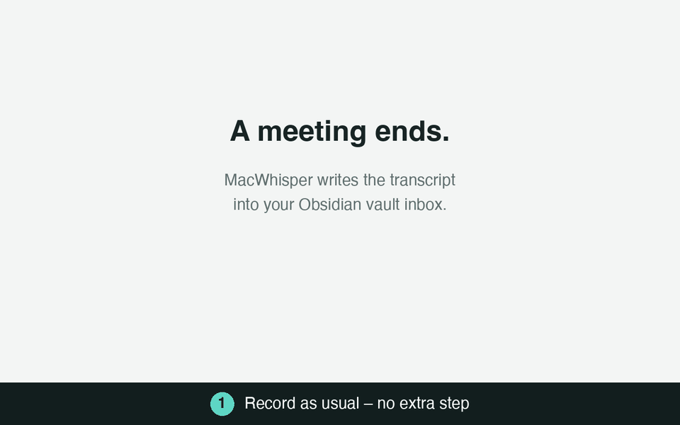

# Debrief

**English** · [Deutsch](README.de.md)

**Every meeting recording, filed in the right place in your Obsidian vault – with summary, decisions and todos – after one quick review.**



*Demo with invented data: a recording becomes a note in `Clients/Acme/platform-migration/Erika Mustermann/`.*

## Why Debrief

Recording meetings is easy. Making them useful is the work: transcripts pile up in an inbox, nobody reads
them again, todos stay buried in the text, and filing them by hand is the first thing that gets skipped.

Debrief turns that pile into a knowledge base you can actually use:

| Without Debrief | With Debrief |
|---|---|
| Transcripts sit unread in one folder | Each one is filed by client, project and person, where you would look for it |
| Todos are somewhere in 40 minutes of text | Your todos are `- [ ]` checkboxes for the Obsidian *Tasks* plugin, others' todos list their owner and due date |
| "What did we decide?" means searching the transcript | Summary and decisions are at the top of every note |
| Speakers are "Speaker 1" and "Speaker 2" | The model suggests who is who, based on how people are addressed and on the calendar invitees |
| The follow-up email is written from memory | A draft is generated from the summary, decisions and todos |
| Handing everything to an AI means trusting it blindly | Nothing is filed before you confirmed it on a local review page; your corrections teach the model |
| Sensitive conversations leave the building | Optionally runs on a self-hosted LiteLLM-compatible gateway, so transcripts stay in-house |

You review a suggestion instead of filing by hand, and the result is
plain Markdown in your own vault: no lock-in, no new app to live in.

## How it works

```
MacWhisper ──(Obsidian integration)──▶ Vault/transkripts/
                                              │  server.py (macOS file system events)
                                              ▼
                                    LLM analysis (claude -p, optionally via your own gateway)
                                              │  suggestion in pending/
                                              ▼
                       Notification ──click──▶ review page http://debrief.localhost:8765
                                              │  "File to Obsidian"
                                              ▼
                       Vault/<category folder>[/<project>[/<person>]]/<date> <title>.md
```

## Features

- **Automatic sorting** into categories, projects and people, with a short reasoning and a confidence value
- **Review page** (German/English, switchable in the header) to correct everything before it is filed
- **Summary, decisions, tags and todos**, written in the language of the conversation
- **Speaker naming** with AI suggestions; the names replace the placeholders everywhere in the note
- **Calendar context:** the matching macOS calendar event (title, organiser, invitees) is passed to the model
- **Follow-up email draft** (formal/informal, German/English) that you can copy or open in your mail client
- **Learns from corrections:** your last corrections are sent along as examples
- **Todos per project:** your todos go into a `Todos.md` in the project folder (with a link back to the conversation);
  the Tasks template and the Task Board show all projects at a glance
- **Duplicate detection**, import of older transcripts (folder search, drag & drop, or pasted text such as a Teams
  chat), keyboard shortcuts
- **Live assistant** during the meeting (`/live`): reads MacWhisper's live transcript, suggests questions, makes its
  assumptions explicit, models the process with event storming and researches in your repositories – see
  [Live assistant](#live-assistant)
- **Event driven**, no polling: FSEvents for the inbox, Server-Sent Events for the page
- **Private by default:** the page only listens on `127.0.0.1`; configuration and learned data stay local

## Requirements

macOS (launchd, FSEvents, calendar helper) and:

| What | Used for | Install |
|---|---|---|
| [mise](https://mise.jdx.dev) (**required**) | installs `uv`, `terminal-notifier`, `jq` and provides the tasks (see `mise.toml`) | `brew install mise` |
| [Claude Code](https://docs.claude.com/en/docs/claude-code) (`claude`) | runs the analysis | `curl -fsSL https://claude.ai/install.sh \| bash` |
| Obsidian + plugin **Local REST API** | MacWhisper writes into the vault through it | Obsidian → Community plugins |
| Xcode Command Line Tools (`swiftc`, optional) | builds the calendar helper | `xcode-select --install` |
| Obsidian plugin **Tasks** (optional) | todo overview across all notes – template `templates/Todos.md`; copy `templates/debrief-tasks.css` to `.obsidian/snippets/` and enable it | Obsidian → Community plugins |
| Obsidian plugin **Task Board** (optional) | kanban board over all todos – template `templates/task-board-todos.json` (insert as `data.boardConfigs[0]` in `.obsidian/plugins/task-board/data.json` while the plugin is off, then enable it and "Scan Vault") | Obsidian → Community plugins |
| Obsidian **Bases** (built in, 1.9+) | conversation overview – copy `templates/Conversations.base` into the vault | – |

## Installation

```sh
git clone https://github.com/schowave/debrief.git && cd debrief
mise trust && mise run install
```

On the first run the installer creates `config.yaml` and `categories.yaml` from the `*.example.yaml` files and stops:
adjust them (vault path, your name, categories) and run `mise run install` again. Both files are git-ignored, so
your personal data never ends up in the repository.

`install.sh` creates `~/Library/LaunchAgents/de.<user>.debrief.plist` for the current user and starts the service.
It runs at login and restarts after a crash. macOS shows "Background item added" once; keep **debrief** allowed under
System Settings → General → Login Items.

### Set up MacWhisper

Settings → Integrations → **Obsidian**:
- IP address/port/API token from the Local REST API plugin
- Folder: the same as `inbox` in `config.yaml` (default `/transkripts`)

Naming speakers in MacWhisper pays off: the todo assignees will be correct.

### mise tasks

| Task | Purpose |
|---|---|
| `mise run install` | install tools, set up or reload the service |
| `mise run uninstall` | remove the service (files and suggestions stay) |
| `mise run restart` | restart the service and wait until the page answers (after code or `config.yaml` changes) |
| `mise run status` | is the service running? which suggestions are open? |
| `mise run open` | open the review page |
| `mise run logs` | follow the logs |
| `mise run dev` | run the server in the terminal; the service pauses meanwhile |
| `mise run calendar-access` | request/check calendar access of the helper |
| `mise run dry-run` | analyse the inbox, only print |
| `mise run sort` | direct mode: file without review |
| `mise run test` | run the tests in `tests/` |
| `mise run lint` | lint the review page with ESLint |
| `mise run check` | lint and tests (runs before every commit after `mise run hooks`) |

## Configuration

**`config.yaml`** (template: [`config.example.yaml`](config.example.yaml))

| Key | Meaning |
|---|---|
| `vault` | path to the Obsidian vault |
| `inbox` | folder in the vault MacWhisper writes to |
| `ich` | your full speaker name in the transcripts (for "my todos"; a first name alone also matches namesakes) |
| `rolle` | optional, your role (e.g. "consultant at Acme") – helps the model |
| `model` | model for `claude -p`, e.g. `sonnet` or a gateway model |
| `sprache` | `de` or `en`: language of notifications (the page remembers its own choice) |
| `gateway.base_url` | optional LiteLLM-compatible gateway. Without `gateway` your normal Claude subscription is used (data then goes to Anthropic) |
| `gateway.token_cmd` / `token_env` / `token` | API key: a command printing it (e.g. `security find-generic-password -s my-gateway -w`), an environment variable, or the key itself |
| `min_konfidenz`, `unklar_ordner` | direct mode only |
| `review.host`, `review.port` | address of the review page. `*.localhost` works without setup; ports below 1024 need admin rights |
| `review.auto_open` | `false`: notification, click opens the page. `true`: opens a browser tab directly |
| `review.mitteilung` | `false` turns notifications off |
| `min_woerter` | shorter recordings are not analysed but offered for discarding |
| `kalender`, `kalender_fenster` | use the calendar event at recording time as context |
| `links` | wikilinks `[[client]]`, `[[project]]`, `[[person]]`, `[[participants]]` at the top of each note (backlinks) |
| `duplikate` | thresholds for duplicate detection |
| `import.ordner` | folders with older transcripts for the import dialog |

**`categories.yaml`** – also editable on the review page under *Settings → Categories*.

```yaml
acme:                           # value of the `kunde` property
  ordner: Kunden/Acme           # target folder in the vault
  hinweise: client project …    # helps the model to assign
  projekte:
    plattform-migration:        # -> Kunden/Acme/plattform-migration/
      hinweise: move to the cloud
      personen: [Erika Mustermann]   # -> Kunden/Acme/plattform-migration/Erika Mustermann/
```

Good `hinweise` (project names, contacts, typical terms) improve the assignment the most.

> The keys in the YAML files and the note format (`kunde:`, `## Transkript`, `## Meine Todos` …) are German on purpose:
> the Obsidian templates in `templates/` and existing notes rely on them.

## Usage

New recording → after 20–60 s a "Review transcript" notification appears → click opens the review page. If the page is
already open it updates itself.

On the page:
- **Title** – edit it directly in the heading
- **Category / project / person** – pick via chips; "AI" marks the model's suggestion. "＋ New …" creates entries
  on the spot, with the switch you remember them permanently. The target path is shown live
- **Name speakers** – "Speaker 1" etc. with a sample sentence; the model suggests a name with reasoning
- **Todos** – "Me"/"Others", assignee, due date, tick to file as already done (`- [x] … ✅ <date>`), flag as
  urgent (`⏫`, also suggested by the model), assign a todo to another project of the same client
- **Summary** (click to edit), **decisions**, **tags**, transcript
- **Follow-up email** – choose formal/informal and the language, create a draft, copy it or open it in the mail client
- **File to Obsidian** (⌘↵) writes the note and jumps to the next open transcript
- **Re-analyse** (also with another model), **Skip** (stays in the inbox), **Discard** (to the macOS trash, undoable)
- **Shortcuts:** <kbd>J</kbd>/<kbd>K</kbd> next/previous, <kbd>1</kbd>–<kbd>9</kbd> category, <kbd>⌘↵</kbd> file, <kbd>?</kbd> overview

The language of the page (DE/EN) is switched in the header. Summaries and todos are written by the model in the
language of the conversation.

More details (direct mode, models and cost, calendar, import, duplicates, settings) are in
[README.de.md](README.de.md).

### Live assistant

`http://debrief.localhost:8765/live` – keep it in its own window next to the call (it never shows up when you share
a browser tab). When MacWhisper starts recording a meeting, a notification "Open live assistant?" appears and the
page attaches to the running recording; finished recordings can be analysed in one go or played back as a replay.

- **Transcript** (left): read-only from MacWhisper's database, lines still being rewritten are grey. Click a speaker
  to name them (calendar invitees are suggested); the names are handed over to the debrief later.
- **Assistant** (middle): every ~75 s, if new confirmed lines arrived (or right away with *Now*), the model suggests
  *questions* (top 3 under "Ask now"), *assumptions*, *open points* and *code references*. Pin, mark as asked or
  answered, drop – dropped ones never come back. Rate assumptions: *correct* / *wrong* (with the correction) become
  facts for every following run, *unclear* turns into a question. The field at the top takes instructions
  ("focus on error cases", kept as a chip until removed) and corrections ("the process starts with the approval",
  turned into a fact automatically).
- **What is listened to**: *Stop listening* (header) keeps everything from now on out of the analysis until you switch
  it on again – unlike *Pause*, which only holds the analysis and catches up afterwards. A paragraph can be switched
  off with the eye next to its time, a speaker for good in *Name speakers*. Such lines stay in the transcript
  (struck through) but never reach the model. What was analysed earlier stays in the summary.
- **Resume**: an ended session carries on with *Resume* – questions, assumptions, process and instructions stay; it
  stays open until you stop it, even if the recording is over or paused for a while. The *Live* link on the review
  page shows a red dot while MacWhisper is recording.
- **New session in the same recording**: *New session from now* ends the session (after one last analysis) and begins
  a new one in the running recording, starting where it is now – context, speaker names and model carry over, questions,
  assumptions and process start empty. The old session ends at that point, so resuming it does not take over the new part.
  The inbox transcript of the whole recording is linked to the session you worked in last.
- **Another recording in the same meeting**: after a break MacWhisper often starts a new recording. *Attach recording*
  (header) appends it to the session: its lines follow on the same time line (with a "Recording 2" divider), questions,
  assumptions and the process stay, and its speakers are counted separately ("Speaker 1 (2)"). In the meeting
  picker a new recording that looks like a continuation (within 4 hours of a session) offers *Continue in: …*.
  The inbox transcript of either recording is linked to the session and gets the right speaker names.
- **Process** (right): an event storming board on process level – actor → command → domain event → policy, read
  models, external systems, aggregates and hotspots, one lane per actor or bounded context. Open questions show as
  red numbered hotspots on the elements they are about. Edit directly (click, drag, connect); everything you touch
  or confirm is locked and the assistant only *proposes* changes to it; deleted elements are not added again.
  The assistant models one process per business flow with the roles as lanes; if there are several processes
  anyway, *Big picture* shows them on one time line (one lane per actor), and *Merge into one process* combines
  them for good.
- **Change the process by instruction**: the field above the board takes plain sentences ("insert a policy for missing
  data after »Project created«", "rename the lane Manager to Team lead"); the assistant carries them out as your own,
  locked edits. *Undo* takes the last instruction, regeneration or applied review finding back.
- **Regenerate**: *Regenerate* builds the process again with everything known by now – conversation, answered
  questions, rated assumptions, instructions, plus a note on what changed. *Revise* keeps what is still right,
  *Rebuild* keeps only your locked elements.
- **Review**: *Review* checks the process like an experienced process modeller – completeness, special cases,
  responsibility, terminology, decisions, data and systems, granularity, consistency with the conversation, metrics.
  What it looks at is a prompt you can edit (per session or saved as default). Findings are not applied by
  themselves: *Apply* (when the fix is clear), *Take over as a question* or *Dismiss* (not reported again).
- **Own window**: *Own window* opens the process alone (`/live?nur=prozess#<session>`), e.g. on a second screen or
  for screen sharing – same session, fully editable.
- **Existing transcripts**: *Insert transcript* (meeting picker) or *Attach recording → Insert an existing transcript*
  take a file from disk (drop it or choose it), pasted text or a transcript from the review inbox: MacWhisper exports,
  Teams chats, WebVTT/SRT, `Name: text` lines or plain text. Without times they are estimated from the speaking
  speed. It becomes a session of its own (analyse or replay it) or follows the last line of the open session.
- **Miro**: *To Miro* draws the big picture into a frame on a Miro board – stickies in event storming colours,
  lanes, arrows, hotspot numbers and the open questions. One way only (debrief → Miro); the next click updates the
  same stickies, items deleted in Miro are drawn again. The board link is asked for once per session.
- **Context** (header): calendar event, category/project (suggested from the event), one or more repositories
  (remembered per project in `categories.yaml` as `repos:`), goal and participants, earlier notes from the project
  folder.
- **Code research**: runs separately with read-only tools (Read/Grep/Glob) in the chosen repositories, so it never
  blocks the live questions; triggered by the analysis or by your own question in the *Code* tab.
- **Model**: per session `claude -p` with your subscription or the LiteLLM gateway, one model for the analysis and
  one for the research.
- **Process library**: *Save to vault* writes `<project folder>/Prozesse/<name>.md` (Mermaid diagram, open
  questions, change history, the model as JSON). *Load from library* brings it into the next meeting as confirmed
  – the assistant refines it and flags deviations.
- **Hand-over**: when the transcript arrives in the inbox, it is linked to the live session (same start time); the
  filed note gets a section "Live-Assistent" with questions, assumptions, open points and the processes.

Long meetings stay fast: the last 15 minutes go into the prompt verbatim, older parts as a running summary.
Sessions are stored in `live/` (git-ignored). Optional settings in `config.yaml`:

```yaml
live:
  takt_s: 75        # automatic analysis at most this often
  fenster_min: 15   # verbatim part of the transcript
  mitteilung: true  # notification when a recording starts
```

For Miro, create an app under *Miro → Settings → Your apps* with the scopes `boards:read` and `boards:write` and the
redirect URI `http://localhost:8765/miro/callback` (your port), then add its client id and secret:

```yaml
miro:
  client_id: "3458764…"
  client_secret_cmd: security find-generic-password -s miro-client-secret -w   # or client_secret_env / client_secret
  board: https://miro.com/app/board/uXjV…=/   # optional: default board
  #redirect_uri: http://localhost:8765/miro/callback   # only if it differs
```

The first *To Miro* opens Miro's login in a small window; debrief keeps the token in `miro_token.json` (git-ignored,
readable only by you) and renews it on its own. Instead of OAuth, a fixed access token works too: `token_cmd`,
`token_env` or `token` under `miro:` (as with the gateway).

## Updating the code

| Changed | Takes effect |
|---|---|
| `static/index.html`, `static/i18n.js` | immediately (reload the page) |
| `categories.yaml` | immediately |
| `server.py`, `debrief.py` | after `mise run restart` |
| `config.yaml` | via *Settings → Configuration* immediately, otherwise `mise run restart` |
| `mise.toml`, `launchd.plist.template` | `mise run install` |

## Files

| File | Content |
|---|---|
| `server.py` | service: watch the inbox, analysis, review page + API |
| `debrief.py` | analysis (prompt, schema), render/file notes; also usable as a CLI |
| `importer.py` | import from folders, drag & drop and the clipboard (Teams chat headers) |
| `transcripts.py` | existing transcripts (MacWhisper export, chat, VTT/SRT, text) as a recording for the live assistant |
| `miro.py` | draws the event storming board on a Miro board (REST API v2) |
| `live.py`, `macwhisper.py` | live assistant (sessions, merge rules, prompts, process library) and read-only access to MacWhisper's database |
| `static/live.html` | live assistant page |
| `tests/` | tests for todo routing, chat import and duplicates (`mise run test`) |
| `static/index.html`, `static/i18n.js` | review page and its English texts |
| `config.example.yaml`, `categories.example.yaml` | templates for your local `config.yaml` / `categories.yaml` |
| `calendar/` | source and build script of the calendar helper (`bin/Debrief Calendar.app`, not in git) |
| `templates/` | Obsidian templates (Bases, Tasks, Task Board) |
| `docs/demo.gif` | walkthrough animation used in the README (made with invented data) |
| `install.sh`, `launchd.plist.template`, `bin/debrief` | service setup |

## Troubleshooting

- **Page does not load:** `mise run status`, `mise run logs`
- **Analysis fails:** the error is shown on the page and in `debrief.log`. Common causes: API key not readable
  (test `token_cmd` in a terminal) or gateway not reachable (VPN?)
- **No notification:** System Settings → Notifications → allow "terminal-notifier"
- **Transcript not picked up:** files are analysed 20 s after their last change; skipped ones are listed as "Skipped"

## Privacy

Transcripts contain client and personnel internals. With a `gateway` they can be processed on models you host
yourself; without it they go to Anthropic through your Claude account. The review page only listens on `127.0.0.1`
and only accepts JSON requests from its own page. `config.yaml`, `categories.yaml` and everything learned
(`learned.json`, `filed.json`, …) stay local and are git-ignored.

## Contributing

Issues and pull requests are welcome. For UI changes please add the English text to `static/i18n.js`
(the German text is the key).

## License

[MIT](LICENSE)
