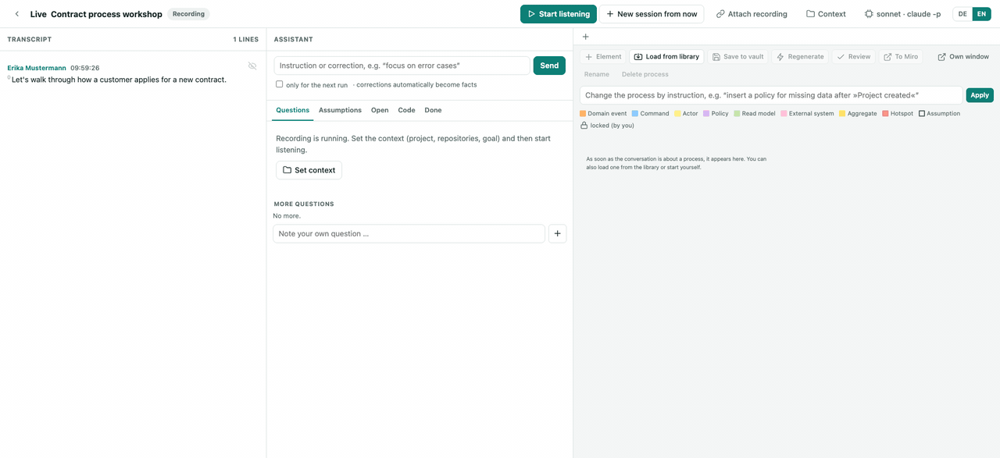

# Live assistant

[← README](../README.md)



*Demo with invented data and a model stub, recorded by `mise run demo`.*


`http://debrief.localhost:8765/live` – keep it in its own window next to the call (it never shows up when you share
a browser tab). When MacWhisper starts recording a meeting, a notification "Open live assistant?" appears and the
page attaches to the running recording; finished recordings can be analysed in one go or played back as a replay.

- **Transcript** (left): read-only from MacWhisper's database, lines still being rewritten are grey. Click a speaker
  to name them (calendar invitees are suggested); the names are handed over to the debrief later.
- **Assistant** (middle): every ~75 s, if new confirmed lines arrived (or right away with *Now*), the model suggests
  *questions* (top 3 under "Ask now"), *assumptions*, *open points* and *code references*. Pin, mark as asked or
  answered, drop – dropped ones never come back. Rate assumptions: *correct* / *wrong* (with the correction) become
  facts for every following run, *unclear* turns into a question. The field at the top takes instructions
  ("focus on error cases", kept as a chip until removed) and corrections ("the process starts with the approval",
  turned into a fact automatically).
- **What is listened to**: *Stop listening* (header) keeps everything from now on out of the analysis until you switch
  it on again – unlike *Pause*, which only holds the analysis and catches up afterwards. A paragraph can be switched
  off with the eye next to its time, a speaker for good in *Name speakers*. Such lines stay in the transcript
  (struck through) but never reach the model. What was analysed earlier stays in the summary.
- **Resume**: an ended session carries on with *Resume* – questions, assumptions, process and instructions stay; it
  stays open until you stop it, even if the recording is over or paused for a while. The *Live* link on the review
  page shows a red dot while MacWhisper is recording.
- **New session in the same recording**: *New session from now* ends the session (after one last analysis) and begins
  a new one in the running recording, starting where it is now – context, speaker names and model carry over, questions,
  assumptions and process start empty. The old session ends at that point, so resuming it does not take over the new part.
  The inbox transcript of the whole recording is linked to the session you worked in last.
- **Another recording in the same meeting**: after a break MacWhisper often starts a new recording. *Attach recording*
  (header) appends it to the session: its lines follow on the same time line (with a "Recording 2" divider), questions,
  assumptions and the process stay, and its speakers are counted separately ("Speaker 1 (2)"). In the meeting
  picker a new recording that looks like a continuation (within 4 hours of a session) offers *Continue in: …*.
  The inbox transcript of either recording is linked to the session and gets the right speaker names.
- **Process** (right): an event storming board on process level – actor → command → domain event → policy, read
  models, external systems, aggregates and hotspots, one lane per actor or bounded context. Open questions show as
  red numbered hotspots on the elements they are about. Edit directly (click, drag, connect); everything you touch
  or confirm is locked and the assistant only *proposes* changes to it; deleted elements are not added again.
  The assistant models one process per business flow with the roles as lanes; if there are several processes
  anyway, *Big picture* shows them on one time line (one lane per actor), and *Merge into one process* combines
  them for good.
- **Change the process by instruction**: the field above the board takes plain sentences ("insert a policy for missing
  data after »Project created«", "rename the lane Manager to Team lead"); the assistant carries them out as your own,
  locked edits. *Undo* takes the last instruction, regeneration or applied review finding back.
- **Regenerate**: *Regenerate* builds the process again with everything known by now – conversation, answered
  questions, rated assumptions, instructions, plus a note on what changed. *Revise* keeps what is still right,
  *Rebuild* keeps only your locked elements.
- **Review**: *Review* checks the process like an experienced process modeller – completeness, special cases,
  responsibility, terminology, decisions, data and systems, granularity, consistency with the conversation, metrics.
  What it looks at is a prompt you can edit (per session or saved as default). Findings are not applied by
  themselves: *Apply* (when the fix is clear), *Take over as a question* or *Dismiss* (not reported again).
- **Own window**: *Own window* opens the process alone (`/live?nur=prozess#<session>`), e.g. on a second screen or
  for screen sharing – same session, fully editable.
- **Existing transcripts**: *Insert transcript* (meeting picker) or *Attach recording → Insert an existing transcript*
  take a file from disk (drop it or choose it), pasted text or a transcript from the review inbox: MacWhisper exports,
  Teams chats, WebVTT/SRT, `Name: text` lines or plain text. Without times they are estimated from the speaking
  speed. It becomes a session of its own (analyse or replay it) or follows the last line of the open session.
- **Miro**: *To Miro* draws the big picture into a frame on a Miro board – stickies in event storming colours,
  lanes, arrows, hotspot numbers and the open questions. One way only (debrief → Miro); the next click updates the
  same stickies, items deleted in Miro are drawn again. The board link is asked for once per session.
- **Context** (header): calendar event, category/project (suggested from the event), one or more repositories
  (remembered per project in `categories.yaml` as `repos:`), goal and participants, earlier notes from the project
  folder.
- **Code research**: runs separately with read-only tools (Read/Grep/Glob) in the chosen repositories, so it never
  blocks the live questions; triggered by the analysis or by your own question in the *Code* tab.
- **Model**: per session `claude -p` with your subscription or the LiteLLM gateway, one model for the analysis and
  one for the research.
- **Process library**: *Save to vault* writes `<project folder>/Prozesse/<name>.md` (Mermaid diagram, open
  questions, change history, the model as JSON). *Load from library* brings it into the next meeting as confirmed
  – the assistant refines it and flags deviations.
- **Hand-over**: when the transcript arrives in the inbox, it is linked to the live session (same start time); the
  filed note gets a section "Live-Assistent" with questions, assumptions, open points and the processes.

Long meetings stay fast: the last 15 minutes go into the prompt verbatim, older parts as a running summary.
Sessions are stored in `live/` (git-ignored). Optional settings in `config.yaml`:

```yaml
live:
  takt_s: 75        # automatic analysis at most this often
  fenster_min: 15   # verbatim part of the transcript
  mitteilung: true  # notification when a recording starts
```

For Miro, create an app under *Miro → Settings → Your apps* with the scopes `boards:read` and `boards:write` and the
redirect URI `http://localhost:8765/miro/callback` (your port), then add its client id and secret:

```yaml
miro:
  client_id: "3458764…"
  client_secret_cmd: security find-generic-password -s miro-client-secret -w   # or client_secret_env / client_secret
  board: https://miro.com/app/board/uXjV…=/   # optional: default board
  #redirect_uri: http://localhost:8765/miro/callback   # only if it differs
```

The first *To Miro* opens Miro's login in a small window; debrief keeps the token in `miro_token.json` (git-ignored,
readable only by you) and renews it on its own. Instead of OAuth, a fixed access token works too: `token_cmd`,
`token_env` or `token` under `miro:` (as with the gateway).

